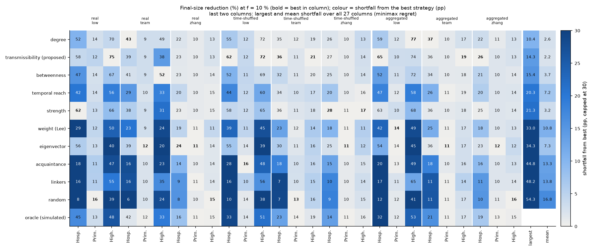
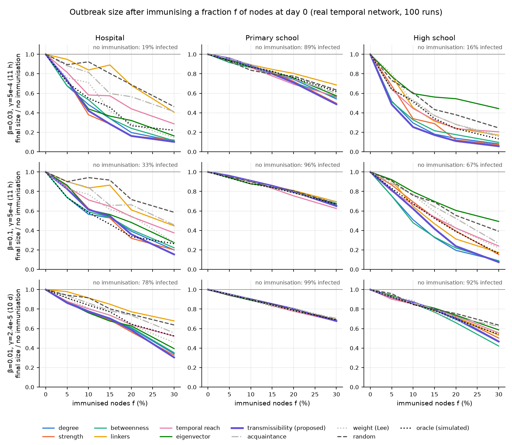
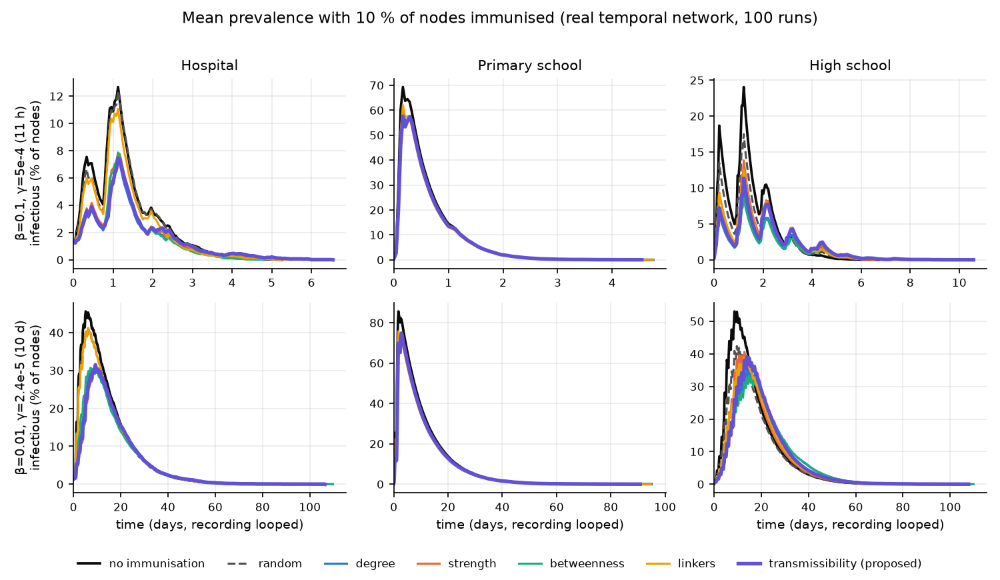
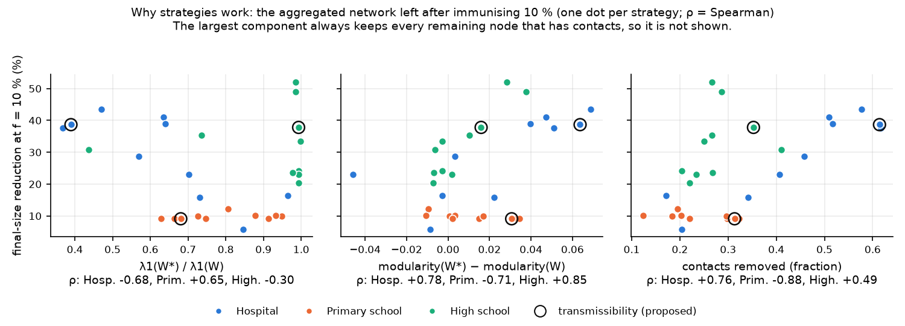
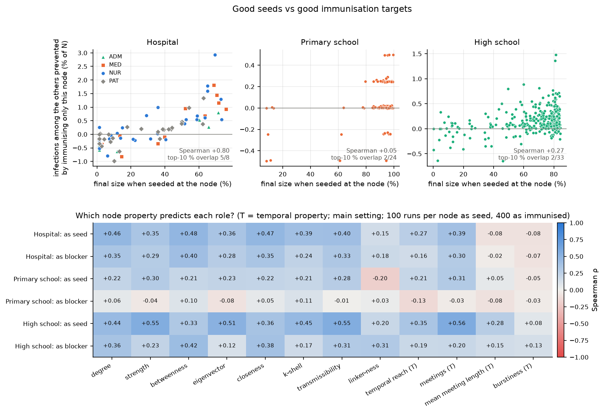
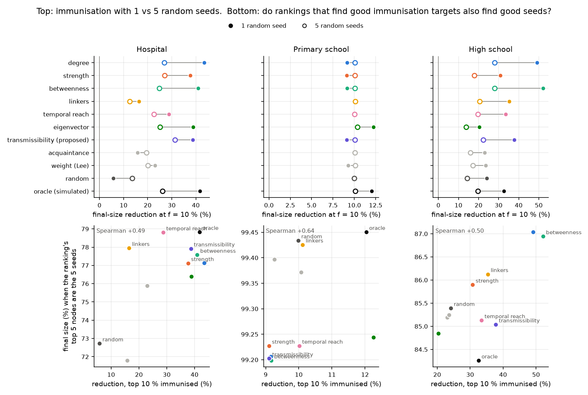

# Stream 6: Immunisation (RQ4) and seeds vs immunisation targets (RQ2)

Which nodes should be immunised to contain an outbreak, can one rule work in a hospital and
in two schools, and are the best people to immunise also the best spreaders? Following the
midterm feedback, nodes are immunised at day 0 with a fixed node budget, on both the
temporal and the aggregated network.

## Message

**Immunise by degree (distinct contacts) or by the proposed transmissibility ranking, not by
contact time.** Among ten strategies, these two never fall more than about 10–15 percentage
points short of the best strategy in any of 27 scenarios (3 datasets × 3 parameter settings ×
3 network versions). Transmissibility has the smallest average shortfall at 4 of 5 budgets.
Immunising 10 % of people cuts the outbreak by about 40 % in the hospital and about 50 % in
the high school, against 6 % and 24 % for random choice. In the primary school no node
strategy beats random: contacts are so dense that any outbreak reaches almost everyone.

## Results

### 1. A general strategy: minimax regret

A strategy's *regret* in a scenario is how many percentage points of final-size reduction
it gives up compared with the best strategy there. The general strategy minimises the
largest regret over all 27 scenarios (Savage's minimax regret). Ratios are avoided because
saturated scenarios, where no strategy beats random, would otherwise add pure noise.

| strategy | largest regret, f = 5 % | 10 % | 15 % | 20 % | 30 % | mean regret, f = 10 % |
|---|---|---|---|---|---|---|
| degree | 9.7 | **10.4** | **6.0** | 8.6 | 6.5 | 2.6 |
| **transmissibility (proposed)** | **8.8** | 14.3 | 8.9 | **5.9** | **4.6** | **2.2** |
| betweenness | 9.2 | 15.4 | 8.5 | 8.9 | 7.0 | 3.7 |
| temporal reach | 22.2 | 20.3 | 29.0 | 27.9 | 24.3 | 7.2 |
| strength (= activity) | 27.6 | 21.3 | 20.3 | 19.8 | 17.3 | 3.2 |
| weight (Lee) | 31.7 | 33.0 | 26.6 | 23.1 | 25.4 | 10.8 |
| eigenvector | 40.1 | 34.3 | 43.1 | 46.3 | 41.7 | 7.3 |
| acquaintance | 31.6 | 44.8 | 46.3 | 48.2 | 34.1 | 13.3 |
| linkers | 31.6 | 48.2 | 60.6 | 51.9 | 48.1 | 13.8 |
| random | 40.3 | 54.3 | 59.9 | 56.1 | 52.6 | 16.8 |

Degree and transmissibility share first place: transmissibility has the lowest largest
regret at 3 of 5 budgets and the lowest mean regret at 4 of 5; degree at the other two.
Transmissibility's worst case (14.3 pp) is the high school in the main setting: with β = 0.1
long within-class contacts saturate, so it ranks closer to strength. Degree needs no disease
parameters, which makes it the simpler choice when β and γ are unknown.



### 2. How much it helps (main setting, real network, f = 10 %)

| strategy | hospital | primary school | high school |
|---|---|---|---|
| degree | 43 [33, 54] | 9 [7, 10] | 49 [42, 55] |
| betweenness | 41 [30, 51] | 9 [7, 10] | **52 [45, 59]** |
| transmissibility (proposed) | 39 [28, 50] | 9 [7, 10] | 38 [31, 45] |
| strength | 38 [24, 49] | 9 [7, 10] | 31 [25, 36] |
| eigenvector | 39 [28, 50] | **12 [10, 15]** | 20 [15, 26] |
| linkers | 16 [4, 28] | 10 [10, 10] | 35 [27, 42] |
| temporal reach | 29 [18, 39] | 10 [10, 10] | 33 [27, 40] |
| weight (Lee) | 23 [13, 32] | 9 [7, 10] | 24 [18, 29] |
| acquaintance | 16 [7, 25] | 10 [10, 10] | 23 [17, 29] |
| random | 6 [−5, 13] | 10 [10, 10] | 24 [18, 31] |
| oracle (simulated) | 42 [30, 53] | 12 [10, 15] | 33 [27, 40] |

Final-size reduction (%) with paired bootstrap 95 % intervals. Without immunisation the
final size is 33 % (hospital), 96 % (primary school) and 67 % (high school).

- **Peaks** fall too: hospital 14.7 % → 8.9 % infectious at the peak (degree), high school
  29.2 % → 11.7 % (betweenness), against 14.5 % and 21.4 % for random. As in the Ebola
  what-if (Rizzo et al. 2016), this is the resource-demand number.
- **H2 is rejected for immunisation:** distinct contacts (degree) beat contact time
  (strength) in the high school, 49 % vs 31 %. Strength equals the activity potential here,
  so the activity-driven-network rule "immunise the most active" (Liu et al. 2014) is the
  weaker choice.
- **H4 is supported for the hospital:** the best strategies all pick high-contact staff.
- **Primary school:** the outbreak is saturated (96 %), so immunising 10 % only removes those
  10 % (reduction ≈ 10 % for every strategy). The same holds with a 10-day infectious period
  in both schools. Class-level measures (Gemmetto, Barrat & Cattuto 2014) would be needed there.
- **The oracle is not an upper bound in the high school** (33 %): the best single nodes do not
  make the best set (Starnini et al. 2013), and its per-node estimates are noisy (section 5).




### 3. Temporal vs aggregated network

Strategies rank the same way on the real, time-shuffled and aggregated networks wherever
they differ: Spearman between versions 0.70–0.98 in the hospital and 0.48–0.99 in the high
school. In the saturated primary school the ranking is noise. This matches Starnini et al.
(2013). What changes is outbreak size: removing contact timing makes outbreaks larger
(high school, main setting: 67 % real, 91 % time-shuffled, 77 % aggregated; the RQ3
hypothesis that aggregation overestimates outbreaks). In larger, near-saturated outbreaks
every strategy helps less: in the high school degree cuts 49 % on the real network but
19 % and 17 % on the shuffled and aggregated ones. With the lower β, where none of the
versions saturates, the three agree (70 %, 72 %, 77 %).

### 4. Why strategies work

Following Zhang, Zhao & Wang (2022, Fig. 2), each strategy's reduction is compared with the
aggregated network left after removing its 10 % (Spearman across strategies):

| property of the remaining network | hospital | high school |
|---|---|---|
| λ1(W*) / λ1(W) | −0.68 | −0.30 |
| modularity(W*) − modularity(W) | +0.78 | +0.85 |
| fraction of contacts removed | +0.76 | +0.49 |

The network never fragments: the largest component keeps every remaining node (the high school's two nodes without any recorded contact aside). In the
hospital, good strategies lower λ1, as the SIS threshold 1/λ1 suggests. In the high school
the two best strategies (degree, betweenness) leave λ1 almost unchanged (≈ 0.99 of the
original) yet work best, because they make the remaining network more modular. That
matches Zhang et al.'s finding for contact removal: modularity, not λ1, explains
mitigation of SIR on temporal networks. The primary school is omitted: its strategies
differ by under 3 points.



### 5. Seeds vs immunisation targets (RQ2)

**Per node** (influence = final size when the node is the only seed; blocking = infections
among the others prevented when only it is immunised):

| | Spearman(seed, blocker) | top-10 % overlap | split-half reliability: seed / blocker |
|---|---|---|---|
| hospital | +0.80 | 5 of 8 | 0.98 / 0.56 |
| primary school | +0.05 | 2 of 24 | 0.51 / 0.32 |
| high school | +0.27 | 2 of 33 | 0.90 / 0.24 |

- In the **hospital** the best spreaders are the best nodes to immunise (staff hubs).
- In the **high school** they differ, as Radicchi & Castellano (2017) found for
  superspreaders vs superblockers. Good seeds have many contacts: number of meetings
  ρ = 0.56, strength 0.55, transmissibility 0.55. Good blockers are bridges: betweenness 0.42,
  closeness 0.38, degree 0.36, linker-ness 0.31, but strength only 0.23 and eigenvector 0.12.
  This is why contact time predicts spreading but not blocking.
- Temporal properties: the number of meetings is the best seed predictor in both schools;
  meeting length and burstiness predict neither role (|ρ| ≤ 0.3).
- **Caution:** immunising one node changes the outbreak by well under 1 % of N, so the
  blocker ranking is only moderately reproducible even with 400 runs per node (split-half
  0.24–0.56). In the primary school no single child matters.

**Per ranking:** strategies that find good immunisation targets also find good seed sets.
Spearman between a ranking's reduction (top 10 % immunised) and the final size when its
top 5 nodes are the seeds: +0.49, +0.64, +0.50. The differences are small (hospital 72–79 %,
high school 84–87 %) because 5 seeds already start a large outbreak. One exception: in the
high school, eigenvector's top 5 (and the oracle's) take 22 h to infect half the school,
against 2–4 h for every other ranking. A plausible reason is that those five nodes sit
together in one tight part of the network; their class labels were not checked.

**1 vs 5 seeds:** with 5 random seeds every strategy loses about a third to half of its
benefit (high school: degree 49 → 28 %, betweenness 52 → 28 %; hospital: degree 43 → 27 %).
Transmissibility loses least in the hospital (39 → 31 %) and is then the best strategy there.




### Limitations

- Rankings use the full recording (feedback: immunise at day 0). Starnini et al. (2013) show
  a few days of observation suffice; that was not re-tested here.
- One time-shuffled realisation per dataset. The aggregated version spreads each link's
  contacts evenly over the recording, nights included.
- Final size counts immunised people as not infected (as in Starnini et al.), so random
  immunisation of a saturated outbreak gives a reduction ≈ f.
- The oracle ranking is computed in-sample on the main setting and reused in the others.
- 100 runs per scenario (feedback), 400 per node for single-node immunisation.

## Method

**Spreading.** Discrete-time SIR on the 20-s contact windows (`f2f.sir`), the same rules as
the team engine (`scripts/spreading.py`): each S–I contact in a window transmits with
probability β, each infected node recovers with probability γ per window. The recording is
looped when the outbreak outlasts it, as in Zhang, Zhao & Wang (2022) and Starnini et al.
(2013). One random seed per run, drawn among non-immunised nodes; 100 runs per cell
(feedback). All scenarios of a stage run side by side with the same random numbers per
run, so differences between strategies are not run-to-run noise. Checked against the team
engine: hospital, β = 0.1, γ = 5·10⁻⁴, 5 seeds, one pass: mean final size 0.721 ± 0.006
(1,200 runs) vs 0.695 ± 0.020 (160 runs).

| setting | β | γ (per 20 s) | mean infectious period | source |
|---|---|---|---|---|
| low | 0.03 | 5·10⁻⁴ | 11 h | lower β, same γ |
| team (main) | 0.1 | 5·10⁻⁴ | 11 h | team's spreading parameters |
| zhang | 0.01 | 2.44·10⁻⁵ | 10 days (10 % recover per day) | Zhang, Zhao & Wang (2022), converted to 20-s windows |

**Network versions.** `real` (the contact sequence), `time_shuffled` (stream 3's null:
same aggregated weighted network and contacts per timestamp, random timing) and
`aggregated` (each link carries its contacts spread evenly over the recording, same β
and γ, 1-hour steps). Node rankings always come from the real data; only the network the
epidemic runs on changes.

**Strategies** (`f2f.immunization`). Immunise the top f·N nodes, f = 5, 10, 15, 20, 30 %.
Link weight = contact count (feedback).

| strategy | rule | source |
|---|---|---|
| random | uniform | Pastor-Satorras & Vespignani 2002 |
| acquaintance | random partner of a random node | Cohen, Havlin & ben-Avraham 2003 |
| weight | most frequent partner of a random node | Lee, Rocha, Liljeros & Holme 2012 |
| degree | distinct partners | Pastor-Satorras & Vespignani 2002 |
| strength | contacts; identical ranking to the activity potential | Liu, Perra, Karsai & Vespignani 2014 |
| betweenness | aggregated, unweighted | Holme, Kim, Yoon & Han 2002 |
| eigenvector | aggregated, weighted; targets λ1, i.e. the SIS threshold 1/λ1 | Van Mieghem, Omic & Kooij 2009 |
| linkers | share of links outside own group closest to 1/2 | Génois et al. 2015 |
| temporal reach | nodes reachable by time-respecting paths within a day | Holme 2005 |
| **transmissibility** (proposed) | Rᵢ = Σⱼ 1 − (1 − β)^(cᵢⱼ D/T), D = 1/γ, T = recording length | Newman 2002 |
| oracle | simulated drop in infections when only i is immunised | Starnini et al. 2013 (τ-protocol) |

Rᵢ is the expected number of people i infects during one infectious period if contacts are
spread evenly in time (Newman's transmissibility per link). For small β it ranks like
strength, for large β like degree. A long tie counts at most once, because transmission
along it happens anyway: the node-level version of Zhang et al.'s finding that removing
contacts from strong ties is wasted effort.

**Outcomes.** As Starnini et al. (final-size ratio) and Zhang et al. (peak height, peak time),
and as the Ebola what-if format of Rizzo et al. (2016): percentage fewer cases, the
prevalence curve, and its peak. 95 % intervals from a paired bootstrap over runs.
The general strategy is the one with the best worst case: at f = 10 %, divide each
strategy's reduction by the best reduction in that cell (dataset × setting × version) and
take the minimum over all cells.

**RQ2.** Per node (main setting, real network): final size when it is the only seed
(influence, 100 runs) and infections among the other nodes prevented when it is the only
node immunised (400 runs; excluding the node itself removes a trivial 1/N effect that
dominates in saturated outbreaks). Split-half reliability is reported because single-node
effects are small. Holme (2017) and Radicchi & Castellano (2017) frame the comparison.

## Reproduction

```bash
python scripts/run_immunization.py        # ~1 h on a 4-core laptop; results/ is git-ignored
python scripts/plot_immunization.py       # figures/immunization/*.png and the tables above
python -m unittest discover -s tests
```

## References

- Cohen, Havlin & ben-Avraham (2003). Efficient immunization strategies for computer networks and populations. PRL 91, 247901. doi:10.1103/PhysRevLett.91.247901
- Gemmetto, Barrat & Cattuto (2014). Mitigation of infectious disease at school: targeted class closure vs school closure. BMC Infect Dis 14, 695. doi:10.1186/s12879-014-0695-9
- Génois et al. (2015). Data on face-to-face contacts in an office building suggest a low-cost vaccination strategy based on community linkers. Network Science 3(3). doi:10.1017/nws.2015.10
- Holme (2005). Network reachability of real-world contact sequences. PRE 71, 046119. doi:10.1103/PhysRevE.71.046119
- Holme (2017). Three faces of node importance in network epidemiology. PRE 96, 062305. doi:10.1103/PhysRevE.96.062305
- Holme, Kim, Yoon & Han (2002). Attack vulnerability of complex networks. PRE 65, 056109. doi:10.1103/PhysRevE.65.056109
- Lee, Rocha, Liljeros & Holme (2012). Exploiting temporal network structures of human interaction to effectively immunize populations. PLoS ONE 7, e36439. doi:10.1371/journal.pone.0036439
- Liu, Perra, Karsai & Vespignani (2014). Controlling contagion processes in activity driven networks. PRL 112, 118702. doi:10.1103/PhysRevLett.112.118702
- Newman (2002). Spread of epidemic disease on networks. PRE 66, 016128. doi:10.1103/PhysRevE.66.016128
- Pastor-Satorras & Vespignani (2002). Immunization of complex networks. PRE 65, 036104. doi:10.1103/PhysRevE.65.036104
- Radicchi & Castellano (2017). Fundamental difference between superblockers and superspreaders in networks. PRE 95, 012318. doi:10.1103/PhysRevE.95.012318
- Rizzo, Pedalino & Porfiri (2016). A network model for Ebola spreading. J Theor Biol 394. doi:10.1016/j.jtbi.2016.01.015
- Starnini, Machens, Cattuto, Barrat & Pastor-Satorras (2013). Immunization strategies for epidemic processes in time-varying contact networks. J Theor Biol 337, 89–100. doi:10.1016/j.jtbi.2013.07.004
- Van Mieghem, Omic & Kooij (2009). Virus spread in networks. IEEE/ACM ToN 17(1). doi:10.1109/TNET.2008.925623
- Zhang, Zhao & Wang (2022). Mitigate SIR epidemic spreading via contact blocking in temporal networks. Applied Network Science 7, 2. doi:10.1007/s41109-021-00436-w
