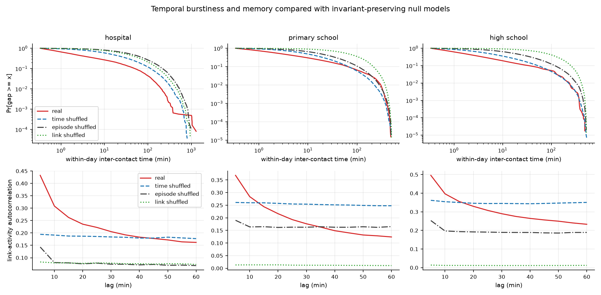

# Stream 3: Temporal Characterisation and Prediction

Stream 3 asks whether the ordering and repetition of face-to-face contacts contain
structure that is absent from randomised contact sequences. It also tests whether
recent contact history improves prediction of the following day's contacts.

## Method

One raw row represents one 20-second face-to-face contact window. Consecutive
windows for the same pair are merged into one contact episode. Inter-contact gaps
are measured between separate episodes of the same pair within one calendar day,
so overnight closures are not treated as human waiting times.

The following quantities are measured:

- **Contact duration:** episode length in seconds.
- **Inter-contact burstiness:** irregularity of the gaps between a pair's meetings;
  positive values indicate clustered activity separated by longer quiet periods.
- **Jaccard similarity:** overlap between the links active in two 5-minute windows.
- **Link-activity autocorrelation:** persistence of link activity between 5-minute
  windows at lags from 5 to 60 minutes.
- **Activity potential:** a node's share of all undirected contact involvements.

Three temporal null models provide random baselines:

- **Time shuffle:** preserves every pair's number of contact windows and the number
  of contacts at every timestamp, but randomises the association between pairs and
  timestamps. It therefore preserves the aggregated weighted network.
- **Episode-time shuffle:** moves complete meetings to other active periods in the
  full recording, possibly on another day. It preserves every pair, episode duration
  and the aggregated weighted network, but not the exact contact count per timestamp.
- **Link shuffle:** preserves the number of contacts at every timestamp and every
  node's total contact involvement, but randomises partners. It deliberately changes
  the aggregated topology.

Both models reject self-contacts and duplicate pair-time records. The reported null
values are means over 20 independently shuffled sequences per dataset and model.

## Temporal Results

| Dataset | Version | Mean duration (s) | Burstiness | Lag-1 Jaccard | Lag-1 autocorrelation |
| --- | --- | ---: | ---: | ---: | ---: |
| Hospital | Real | 46.198 | 0.451 | 0.284 | 0.433 |
| Hospital | Time shuffled | 20.547 | 0.258 | 0.073 | 0.193 |
| Hospital | Episode-time shuffled | 46.198 | 0.134 | 0.063 | 0.144 |
| Hospital | Link shuffled | 20.174 | 0.150 | 0.030 | 0.083 |
| Primary school | Real | 32.449 | 0.411 | 0.244 | 0.368 |
| Primary school | Time shuffled | 20.776 | 0.267 | 0.150 | 0.261 |
| Primary school | Episode-time shuffled | 32.449 | 0.182 | 0.110 | 0.189 |
| Primary school | Link shuffled | 20.050 | -0.036 | 0.016 | 0.015 |
| High school | Real | 55.761 | 0.481 | 0.390 | 0.496 |
| High school | Time shuffled | 21.826 | 0.357 | 0.209 | 0.361 |
| High school | Episode-time shuffled | 55.761 | 0.203 | 0.146 | 0.253 |
| High school | Link shuffled | 20.031 | -0.050 | 0.009 | 0.014 |

The real networks have longer episodes, greater burstiness and substantially more
short-term link memory than their null models. Shuffled durations approach 20 seconds
because randomisation separates most originally consecutive sensor observations.

Episode-time shuffling keeps the real duration distribution exactly, yet lag-1
autocorrelation falls from 0.433, 0.368 and 0.496 to 0.144, 0.189 and 0.253. Meeting
duration therefore explains only part of the observed short-term memory; the
original scheduling and repetition of meetings also matter.

The null models are not nested and need not have a fixed ordering. In particular,
window-level time shuffling preserves exact contact volume at every timestamp,
whereas episode-time shuffling preserves complete meetings instead. Link shuffling
removes stable partners and group structure as well, leaving autocorrelation of only
0.083 in the hospital and approximately 0.015 in both schools.

The differences from the null ensembles are much larger than their run-to-run
variation. Exact z-score magnitudes are not substantively important; the defensible
conclusion is that the direction of every main temporal effect is highly robust.



The figure uses one fixed-seed realisation for each displayed null curve. The
table and z-score files use all 20 realisations.

## Next-Day Prediction

The self-driven model assigns exponentially decreasing weight to older link
activity. We adapt its next-snapshot score to a day-ahead ranking: its decay
parameter is selected using the first day, and at each later day it ranks only links
observed before that day. It is compared with an unweighted frequency baseline over
the same 24-active-snapshot history window. Performance is average precision (AP).

| Dataset | Self-driven AP | Frequency AP | Seen-link coverage | Predicted days |
| --- | ---: | ---: | ---: | ---: |
| Hospital | 0.335 | 0.327 | 0.446 | 4 |
| Primary school | 0.734 | 0.736 | 0.564 | 1 |
| High school | 0.445 | 0.444 | 0.612 | 4 |

The self-driven model does not consistently outperform simple frequency. Recent
temporal memory is strong over minutes, but adds little when predicting whether a
link will appear at any point during an entire following day.

Coverage is reported because the model does not use future topology. For example,
hospital coverage of 0.446 means that 44.6% of the links active on a target day had
already been observed and could be ranked. The remaining links were new and cannot
be predicted by either evaluated method. AP therefore evaluates ranking quality
among previously observed candidate links, while coverage describes this limitation.

The primary-school result is based on only one validation day because that dataset
contains two recorded days. It should not be presented as strong evidence that one
predictor is better than the other.

## Outputs

The main tracked output is:

- `figures/rq1_temporal_vs_null.png`

Generated tables under `results/` and shuffled contacts under `data/processed/` are
git-ignored but reproducible. Important files include:

- `results/temporal_summary_all.csv`
- `results/temporal_zscores_all.csv`
- `results/prediction_evaluation_all.csv`
- `results/activity_potential_<dataset>.csv`
- `results/predicted_contacts_<dataset>.csv`
- `data/processed/<dataset>_time_shuffled.parquet`
- `data/processed/<dataset>_episode_time_shuffled.parquet`
- `data/processed/<dataset>_link_shuffled.parquet`

## Reproduction and Verification

```bash
python scripts/check_data.py
python -m unittest discover -s tests
python scripts/run_temporal_characterisation.py --n-null 20
```

The final run used seed `4310`, 5-minute memory bins, lags up to 60 minutes,
24 active snapshots of prediction history and three randomisation sweeps per contact.
All three dataset checksums and all nine Stream 3 tests passed. The tests verify the
episode construction, activity normalisation, memory calculation, self-driven score,
next-day candidate handling and the exact invariants of both null models.

The self-driven model follows Zou, Ceria and Wang, *Short- and long-term temporal
network prediction based on network memory*, Applied Network Science 8:76 (2023),
<https://doi.org/10.1007/s41109-023-00597-w>.
